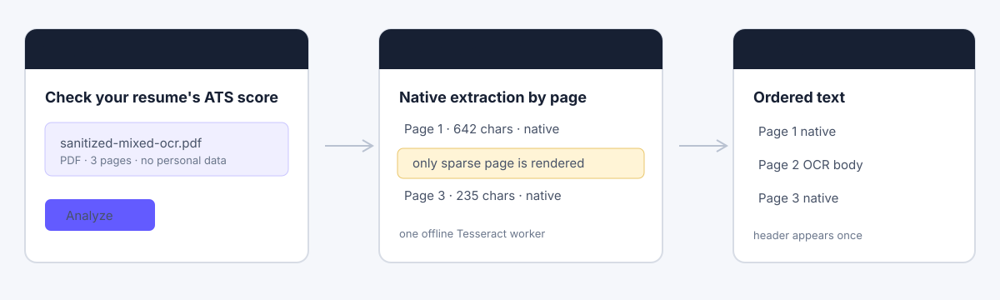

# Per-page OCR fallback

Resumate extracts PDF text page by page and falls back to offline OCR only for
pages whose native extraction is too small to be useful.

## Problem

The old parser made one document-wide decision: if the combined selectable text
was long enough, it skipped OCR. A scanned page could therefore disappear when
the other pages contained enough native text. A selectable header or page number
made that failure especially easy to miss.

## Heuristic

A page is an OCR candidate when its selected native text has fewer than **40
alphanumeric characters or fewer than 5 words**. This deliberately simple rule
recognizes that a header/page number is not meaningful body text. Pages that meet
the threshold stay native unless OCR produces a longer, more usable result.

## Flow



```text
PDF
 │
 ├─ native text by page ─┐
 └─ tables by page ──────┴─ choose best native text per page
                              │
                    flag sparse pages only
                              │
                    render flagged pages only
                              │
                 offline Tesseract, one worker
                              │
                 keep the better page result
                              │
             join pages in PDF order with blank lines
```

`pdf-parse` 2.4.5 supports 1-based page selection through `partial`. Resumate
uses `getScreenshot({ partial: pageNumbers, scale: 2 })`, so unflagged pages are
not rendered for OCR. The same release returns native text pages with `num` and
rendered screenshots with `pageNumber`; those keys keep page order stable.

Page-level table extraction is preferred for placement. Merged-table rows are
added only when they are not already present, and each supplemental row is
placed once to avoid duplicating a merged table in the final text.

OCR runs offline with Tesseract.js. One worker is reused for all flagged pages
in a PDF. A failed or empty OCR result leaves the native page text intact.
The parser always destroys the PDF parser in `finally`, and the OCR helper
terminates its worker in `finally`, including failure paths.

## Sanitized mixed-page fixture

The fixture contract in [`fixtures/per-page-ocr/`](../fixtures/per-page-ocr/)
contains generic, non-identifying content only. It models a three-page PDF:

- Page 1: selectable native text.
- Page 2: a selectable `Sample Resume | 2` header over a body rendered as an
  image; the body is intentionally not part of native extraction.
- Page 3: selectable native text.

The page-2 body source is kept as plain text beside the fixture description so a
PDF/image generator can render it without committing personal data.

## Expected result

```text
Page 1: native text, no OCR
Page 2: OCR only
Page 3: native text, no OCR
Output order: page 1 → page 2 → page 3
Header: appears once
```

Observed **native-extraction** metrics from the mixed OCR sample, before OCR:

```text
page 1: 642 chars / 106 words / OCR false
page 2: 8 chars / 3 words / OCR true
page 3: 235 chars / 42 words / OCR false
```

Page 2 has much more content in its scanned image than the native metrics show.
Those 8 characters are only the selectable `Sample Resume | 2` header. OCR
reads the full rendered page, replaces that sparse native result when it is
better, and supplies the scanned body in the final output.

The local app run scored the mixed-page sample successfully at 86/100. The
parser output placed the full OCR page 2 between pages 1 and 3 and emitted its
page-2 header once. The storyboard above is sanitized for public documentation.

## Before and after

| Parser behavior | Mixed PDF result |
| --- | --- |
| Document-wide threshold | Scanned page can be silently skipped |
| Per-page fallback | Only sparse page is OCR’d and retained in place |

The local upload flow can be demonstrated with `npm run dev`, then uploading the
fixture and opening the result page. Do not publish real resumes or screenshots
that contain names, contact information, or employer-specific content.
